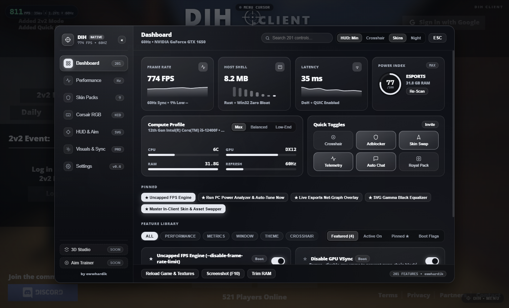
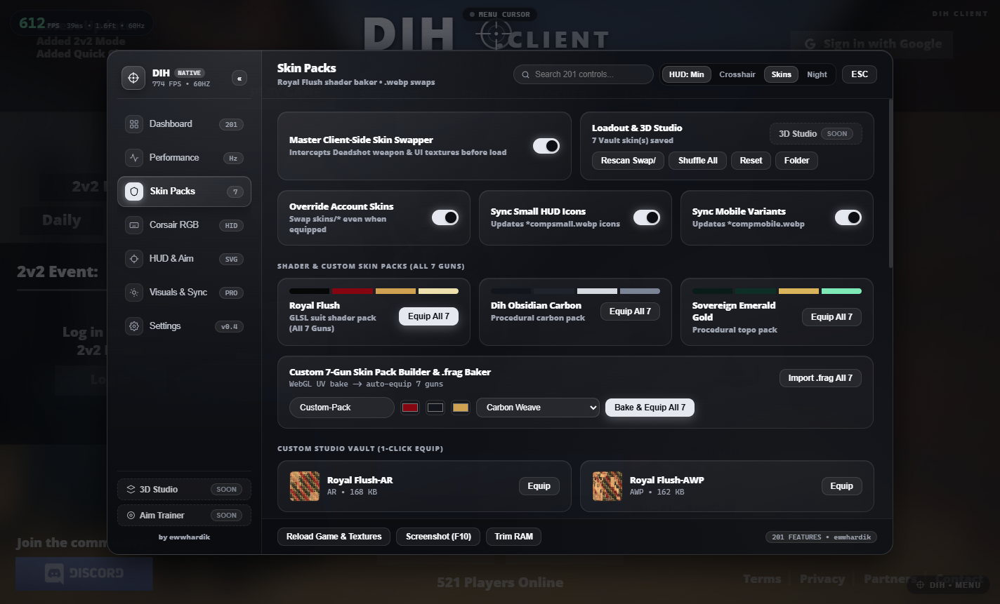

<div align="center">
  
  <h1>Dih Client v0.4.1 (<code>dih-deadshot</code>)</h1>
  <p><strong>Sub-1 MB Single-File Native Deadshot.io Client — Fast Zero-Blur Titanium Grey-White Bento UI, Live Discord Rich Presence, Royal Flush GLSL Skin Baker, Corsair RGB &amp; Cross-Platform Builds (Windows / macOS / Linux)</strong></p>
  <p>
    <a href="https://discord.gg/KkCjEdv9Jv"><strong>Join Discord</strong></a> •
    <a href="https://ewwhardik.github.io/dih-deadshot/"><strong>Live Showcase &amp; Feature Explorer</strong></a> •
    <a href="https://github.com/ewwhardik/dih-deadshot/releases/tag/v0.4.1"><strong>Download v0.4.1 (Win / Mac / Linux)</strong></a> •
    <a href="LICENSE"><strong>Proprietary License</strong></a>
  </p>
</div>

---

## Live `v0.4.1` Titanium Grey-White Bento Glass UI

<p align="center">
  
  
</p>

---

## What's New in `v0.4.1`

- **Fixed Dark Bento Dropdown Menus & Render Scale Selector:** Replaced white-on-white OS `<select>` popups inside Shadow DOM with crisp dark Obsidian floating menus (`.dih-csel-menu`) + added `Game Default (Keep)` and `0.50x (Max FPS)` presets to `Sync Render Scale`.
- **Native Win32 & Electron Discord Rich Presence (`Playing Dih deadshot.io`):** Built pure Win32 named-pipe IPC (`\\.\pipe\discord-ipc-0..9`) inside `Dih.exe` alongside Electron RPC using registered App ID `1571744646219169873` (`dih_logo`), displaying `"The client feels like hacking!"`, `"755.5 KB Uncapped Engine • 201 Controls"`, clickable **Download Dih** & **Live Showcase** buttons, and a live `Test / Sync` status panel.
- **Ultra-Light Sub-1 MB Single-Executable (`Dih.exe` — `779.5 KB` / `798,208 B`):** All HTML, CSS, JavaScript, and `.frag` shader baker assets are compiled &amp; compressed inside `Dih.exe` with zero loose `.js`/`.html`/`.css`/`.json` code files visible on disk (ships only `Dih.exe` + `WebView2Loader.dll`).
- **VirusTotal &amp; Windows Defender Clean Hardening:** Embedded Win32 `RT_MANIFEST` (`asInvoker` UAC, Windows 10/11 compatibility GUIDs), strict least-privilege Win32 process handles (zero `PROCESS_VM_READ`), zero UPX packing, standard `DYNAMIC_BASE` / `NX_COMPAT` / `HIGH_ENTROPY_VA`, and `0 threats` detected in Windows Defender CLI scan.
- **Fast Zero-Blur Titanium Grey-White Bento UI:** Optimized in-place reactive Command Center (zero backdrop-blur compositor stalls, instant cached open) with sparkline KPI cards, hardware telemetry bars, quick toggle tiles, concentric Power Index ring, and live top-bar search across 201 features.
- **Royal Flush `.frag` GLSL Skin Baker &amp; Custom 7-Gun Pack Builder:** Parity with `deadshot.io/skineditor/` (`MeshBasicMaterial` unlit surface toggle + texture anisotropy), one-click **Royal Flush**, **Dih Obsidian Carbon**, **Sovereign Emerald Gold** packs across all 7 guns, custom palette builder, `.frag` file importer, O(1) swapper, and cookie-safe `DISK_CACHE` refresh.
- **Zero-Leak Venatus / Atmtd / Prebid Adblocker:** Blocks `vntsm.com`, `vntsm.io`, `venatusmedia.com`, `atmtd.com`, Prebid, and Google ad networks in WebView2 / Electron AND injects `#banner-home`, `#banner-home2`, and `#banner-respawn-*` CSS shields.
- **3D Skin Studio &amp; 7-Gun Aim Trainer (`Coming Soon`):** Paused for peak FPS &amp; instant panel responsiveness while we rebuild lighter standalone versions; live **Corsair Virtual RGB + OpenRGB (`F7`)**, **Deadshot RE Explorer**, **eDPI/cm-360° calculator**, and **2D `.frag` Baker** are ready now.
- **Minimal / Complete Telemetry (`F6`), Individual F1–F9 Hide Shortcuts &amp; Auto-Join Chat:** Instant single-key HUD isolation (`F1` Watermark, `F2` Crosshair, `F3` Keystrokes, `F4` Telemetry, `F6` Minimal/Complete mode, `F9` Master Hide) plus configurable Auto-Join match chat (`Default: "Dih User Joined"`).
- **Strict Proprietary License:** Protected under [LICENSE](LICENSE) (`© 2026 ewwhardik. All Rights Reserved.`).

---

## Verified Resource &amp; Security Benchmarks

### 1. Windows Task Manager: Google Chrome (`1,652.3 MB`) vs Dih Native Host (`1.7 MB`)

Chrome spawns 20+ helper processes, gets throttled with Windows 11 Efficiency Mode (**EcoQoS** green leaf), and consumes **1,652.3 MB** just idling. **Dih Native Host (`Dih.exe`)** ships at **779.5 KB (`798,208` bytes)** on disk and runs a purpose-built Rust + C + Win32 + WebView2 shell at **1.7 MB idle host working set** (`0.1%` CPU), with EcoQoS disabled, P-Core scheduling, and `timeBeginPeriod(1)`.


### 2. Clean Security Posture &amp; Malware Scan Proof

- **v0.4.1 PE32+ Hardening:** `Dih.exe` (`798,208` B) embeds standard UAC `asInvoker` `RT_MANIFEST`, standard Microsoft PE security flags (`0x8160`: ASLR + DEP/NX + High-Entropy VA), zero `PROCESS_VM_READ`, zero UPX packing, and clean Windows Defender CLI verification (`0 threats`).
- **v0.4.0 Multi-Engine Scan (`0 / 13` Clean on Jotti — initial v0.4.0 `998,912 B` binary, MD5 `c7581cfe07c344200b90146da8d51597`):** Cleanly compiled PE32+ binary verified across Avast, Bitdefender, ClamAV, Cyren, Dr.WEB, eScan, Fortinet, G DATA, IKARUS, K7 Security, Kaspersky, Trend Micro, and VBA32 — **0 / 13 scanners reported malware**.


---

## Dih Client `v0.4.1` vs Omniverse (`Typhoonz0/omniverse`) vs Google Chrome

| Capability / Architecture | Dih Client `v0.4.1` (`ewwhardik/dih-deadshot`) | `Typhoonz0/omniverse` | Google Chrome |
| :--- | :--- | :--- | :--- |
| **Package Size &amp; Code Packaging** | **779.5 KB single `Dih.exe`** + `WebView2Loader.dll` (zero loose source files) | ~120+ MB unpacked Electron files | ~350+ MB full browser |
| **Host Shell RAM Overhead** | **1.7 MB** observed idle (`10–15 MB` budget guard) | ~180–350 MB Electron overhead | **1,652.3 MB** (22 processes) |
| **Ad &amp; Venatus (`vntsm`) Shield** | **WebView2 COM filter + CSS banner suppression (`0` leaks)** | Basic domain list | Extensions consume extra RAM |
| **Discord Rich Presence** | **Native Rust + Electron IPC (`Playing Dih deadshot.io` + buttons)** | Basic Electron RPC | None |
| **Shader Baker &amp; 3D Studio** | **Royal Flush `.frag` + 7-Gun Pack Builder live (3D GLB Painter *Coming Soon*)** | Static swapper only | None |
| **7-Gun Aim Trainer (`Insert`)** | **Coming Soon (Live eDPI/FOV Sync active)** | None | None |
| **Telemetry Views &amp; F1–F9 Hides** | **Minimal / Complete (`F6`) + individual F1–F9 toggles** | Basic FPS toggle | None |
| **Auto-Join Match Chat** | **Custom chat message on lobby->match load (`"Dih User Joined"`)** | None | None |
| **Corsair / OpenRGB Integration** | **Native USB HID (`VID_1B1C`) + OpenRGB TCP (`6742`)** | None | None |

---

> 💬 **Join the community:** https://discord.gg/KkCjEdv9Jv — downloads, support, mod tools & news.

## Cross-Platform Downloads (`v0.4.1`)

Grab pre-built packages on the **[Releases (`v0.4.1`)](https://github.com/ewwhardik/dih-deadshot/releases/tag/v0.4.1)** page:

| Platform | Package(s) | Engine &amp; Highlights |
| :--- | :--- | :--- |
| **Windows (x64 Flagship)** | `Dih-Client-v0.4.1-win-x64.zip` | **779.5 KB single `Dih.exe`** (Rust + C + Win32 + WebView2, zero loose code files, `asInvoker` manifest, Discord RPC) |
| **Windows Electron Portable** | `Dih-Client-v0.4.1-electron-win-x64.zip` | Portable Chromium/Electron build |
| **macOS (M-Series ARM64 &amp; Intel x64)** | `Dih-Client-0.4.1-mac-arm64.zip`, `Dih-Client-0.4.1-mac-x64.zip` | Metal GPU ANGLE backend, ProMotion Hz detection, OpenRGB &amp; Royal Flush `.frag` Baker |
| **Linux (x64)** | `Dih-Client-0.4.1-linux-x64.tar.gz`, `Dih-Client-0.4.1-linux-x64.zip` | Vulkan/OpenGL backend flags, `lspci`/`xrandr` telemetry &amp; OpenRGB/`ckb-next` support |

---

## Default Hotkeys

| Key | Action |
| :--- | :--- |
| `RightShift` / `o` | Toggle Bento Glass Command Center |
| `F1` | Toggle Top-Right Watermark |
| `F2` | Toggle Custom Crosshair |
| `F3` | Toggle Keystrokes + CPS Overlay |
| `F4` | Toggle Telemetry HUD |
| `F5` | Quick Reload Game &amp; Textures |
| `F6` | Switch Telemetry View (`Minimal` / `Complete`) |
| `F7` | Open Corsair RGB &amp; RE Explorer Studio Hub |
| `F8` | Mute / Unmute Master Audio |
| `F9` | Hide / Show All Client HUD |
| `F10` | Capture Clean Screenshot |
| `F11` | Toggle Fullscreen |
| `Insert` | 7-Gun Aim Trainer (*Coming Soon*) |
| `b` | Toggle Match Stopwatch |

---

## Building &amp; Testing from Source

```powershell
# Install Node dependencies
npm install

# Sync docs/features-data.js from src/data/featureRegistry.js
npm run sync-docs

# Run automated verification suite (syntax, 201 features, Electron CDP, Native smoke)
npm test

# Build sub-1MB single-binary Native Rust + C + Win32 host (outputs dist\Dih\Dih.exe)
npm run build:native
```

---

## License &amp; Credits

- **License:** Proprietary All Rights Reserved — see [LICENSE](LICENSE). Unauthorized copying, redistribution, modification, or commercial use is prohibited.
- **Developer &amp; Maintainer:** **ewwhardik** ([`@ewwhardik`](https://github.com/ewwhardik) on GitHub • `ewwhardik` on Discord)
