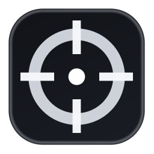
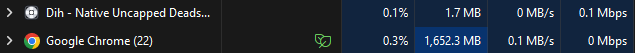
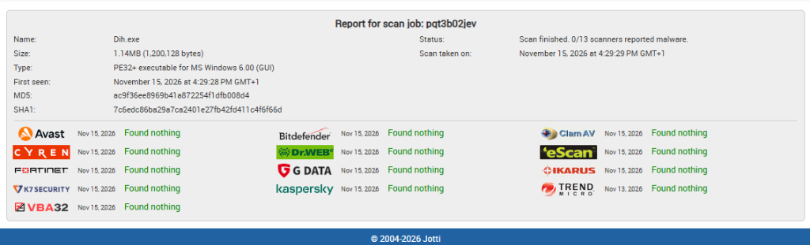

<div align="center">
  
  <h1>Dih Client v0.3 (<code>dih-deadshot</code>)</h1>
  <p><strong>Minimalist, Cross-Platform High-FPS Deadshot.io Client — Native Rust + C + Win32 Host (~1.7 MB Host RAM), macOS &amp; Linux Builds, PC Power Auto-Tune &amp; 196 Wired Features</strong></p>

  <p>
    <a href="https://ewwhardik.github.io/dih-deadshot/"><strong>Live Interactive Showcase &amp; Sandbox</strong></a> •
    <a href="https://github.com/ewwhardik/dih-deadshot/releases/tag/v0.3"><strong>Download v0.3 (Win / Mac / Linux)</strong></a> •
    <a href="#features-overview"><strong>196 Features</strong></a>
  </p>
</div>

---

## Verified Resource & Security Benchmarks

### 1. Windows Task Manager: Google Chrome (`1,652.3 MB`) vs Dih Native Host (`1.7 MB`)

Chrome spawns 20+ helper processes, gets throttled with Windows 11 Efficiency Mode (**EcoQoS** green leaf), and consumes **1,652.3 MB** just idling. **Dih Native Host (`Dih.exe`)** runs a purpose-built Rust + C + Win32 + WebView2 shell at **1.7 MB host working set** (`0.1%` CPU), with EcoQoS explicitly disabled across the process tree (`SetProcessPriorityBoost`, P-Core `SetProcessAffinityMask`, and `timeBeginPeriod(1)`).



### 2. Independent Malware Scan Proof: `0 / 13` Scanners Clean (Jotti)

Verified cleanly compiled PE32+ executable (`Dih.exe`, `1.14 MB`) on Jotti (scan job `pqt3b02jev`) across Avast, Bitdefender, ClamAV, Cyren, Dr.WEB, eScan, Fortinet, G DATA, IKARUS, K7 Security, Kaspersky, Trend Micro, and VBA32 — **0 / 13 scanners reported malware**.



---

## Dih Client v0.3 vs Omniverse (`Typhoonz0/omniverse`) vs Google Chrome

| Capability / Architecture | Dih Client v0.3 (`ewwhardik/dih-deadshot`) | `Typhoonz0/omniverse` | Google Chrome |
| :--- | :--- | :--- | :--- |
| **Core Runtime** | **Rust + C + Win32 + WebView2** (Windows flagship) + **macOS &amp; Linux** Electron builds | Electron JS wrapper | Multi-process general browser |
| **Host Shell RAM Overhead** | **1.7 MB** observed idle (strict `10–15 MB` budget + live trim) | ~180–350 MB Electron shell overhead | **1,652.3 MB** (22 processes captured) |
| **Windows 11 Scheduling** | **Full EcoQoS tree bypass + `timeBeginPeriod(1)` + P-Core Affinity + Focus Scaling** | Chromium launch flags only | Throttled by Windows EcoQoS (green leaf) |
| **First-Boot PC Power Analyzer** | **Animated Boot Phase**: scores CPU, GPU, RAM &amp; Hz (`10–100`) &amp; auto-tunes optimal preset | None | None |
| **Wired Client Features** | **196 features** (Black-EQ, Net-Graph, DPR Scaler, Pinned Favorites, Sub-Tabs) | Launcher, basic swapper &amp; crosshair | 0 native client features |
| **Interactive Crosshair + Pro HUD** | Reactive spread, hitmarker X + sound, ADS scale, Weapon Slot `1/2/3`, Reload timer, `DIH-XHAIR:` codes | Static overlay image | None |
| **Built-In 3D Skin Studio** | **Offline Three.js + Draco `.GLB` preview, UV paint brushes &amp; local `.webp` vault** | Static file replacement only | None |
| **Corsair / OpenRGB Integration** | **Real-time `6x22` key matrix + reactive health/firing/ping/ADS lighting** | None | None |
| **Cross-Platform Releases** | **Windows (`Dih.exe`), macOS (`arm64` + `x64` `.dmg`/`.zip`), Linux (`.AppImage`/`.deb`/`.tar.gz`)** | Desktop Electron | Cross-platform browser |

---

## Animated Boot Phase &amp; PC Power Auto-Tune

Every time Dih Client boots cleanly (and on first launch auto-configuration), it runs a 3-phase hardware analysis pipeline (`bootAnalyzer.js` + `hw_analyzer.rs` / `systemMetrics.js`):

1. **System Scan:** Probes CPU core/thread count, RAM capacity, DXGI/Metal/OpenGL GPU specs, and live monitor refresh rate (`Hz`).
2. **Power Scoring (`10–100`):** Classifies the machine into `extreme_workstation`, `esports_desktop`, `balanced_laptop`, or `low_end_pc`.
3. **Auto-Tune Selection:** Defaults to **`Max Compute`** on capable hardware so WebGL stays `desynchronized` with high-performance scheduling, or safely switches to **`Balanced`** / **`Low-End PC`** (scaling DPR cleanly to preserve FPS). You can switch presets anytime in the Command Center Hero card or re-run analysis.

---

## Interactive Website &amp; Live Client Preview

Explore all **196 features** live in your browser on the **[Dih Client GitHub Pages Showcase](https://ewwhardik.github.io/dih-deadshot/)**:

- **Live PC Power Simulator:** Test hardware tiers &amp; inspect recommended WebGL / Win32 / DPR flags.
- **Crosshair, Black-EQ &amp; Net-Graph Sandbox:** Design pro crosshairs, generate shareable `DIH-XHAIR:` codes, preview SVG Black Equalizer &amp; live scrolling frame-time/ping graph.
- **3D Skin Studio &amp; Corsair `6x22` Keyboard Preview:** Preview official skins + reactive Corsair lighting zones (`reactive_tactical`, `fps_thermal`, `ping_health`, `reload_sweep`, etc.).
- **Searchable 196-Feature Catalog:** Filter all features by category &amp; status.

---

## Cross-Platform Downloads (`v0.3`)

Grab pre-built packages on the **[Releases (`v0.3`)](https://github.com/ewwhardik/dih-deadshot/releases/tag/v0.3)** page:

| Platform | Package(s) | Engine &amp; Highlights |
| :--- | :--- | :--- |
| **Windows (x64 Flagship)** | `Dih-Client-v0.3-win-x64.zip` | Native Rust + C + Win32 + WebView2 (`1.7 MB` host shell, P-Core affinity, Priority Boost, `timeBeginPeriod(1)`) |
| **macOS (Apple Silicon &amp; Intel)** | `Dih-Client-0.3.0-mac-arm64.dmg`, `Dih-Client-0.3.0-mac-x64.dmg`, `.zip` | Chromium/Electron with Metal ANGLE backend, `system_profiler` ProMotion Hz &amp; USB Corsair detection |
| **Linux (x64)** | `Dih-Client-0.3.0-linux-x64.AppImage`, `.deb`, `.tar.gz` | Vulkan/OpenGL backend flags, `lspci`/`xrandr` telemetry &amp; OpenRGB/`ckb-next` support |

---

## <a id="features-overview"></a>Key Capabilities Across 9 Categories (196 Features)

1. **Performance &amp; FPS:** Max Compute default preset, Win32 Process Priority Boost, P-Core affinity mask, Focus Priority Scaling, EcoQoS bypass, `timeBeginPeriod(1)`, `--disable-smooth-scrolling`, early pre-DOM WebGL `desynchronized` + `powerPreference: "high-performance"`, dynamic `canvasDprScale`, live host RAM trimmer (`10–15 MB` budget).
2. **Real PC Metrics &amp; HUD:** Uncapped RAF FPS counter, `1% Low FPS`, frame-time jitter, scrolling Net-Graph canvas, Session K/D/Kills/Time stats pill, Weapon Slot `1/2/3` badge, `R` reload sweep bar, Pointer Lock status LED, real CPU/GPU/RAM/Monitor Hz polling.
3. **Window &amp; Privacy:** Borderless / Always-on-Top / Opacity slider, Discord Rich Presence, Context Menu block, Close confirmation dialog, targeted ad/tracker blocker without wildcard COM stalls.
4. **Grey Minimalist UI &amp; Easy Navigation:** Obsidian/Titanium minimal theme, Hero Hardware Power Card, Pinned Favorites strip (`★` / `☆`), Sub-Tab pills inside dense tabs, filter chips (`All` / `Active On` / `Pinned` / `Restart Flags`), compact rail toggle.
5. **Skin Changer &amp; 3D Skin Studio:** Official + custom skin interceptor, 7-weapon selector, Three.js + Draco `.GLB` offline 3D inspector, layer paint studio &amp; local `.webp` vault.
6. **Corsair &amp; OpenRGB Sync:** Real-time `6x22` key matrix with 8 lighting modes and WebHID / OpenRGB TCP packet bridge.
7. **Crosshair &amp; Visuals/Audio:** Custom dot/gap/length/thickness/outline/ADS/WASD velocity spread, diagonal hitmarker flash + WebAudio synth, SVG `<feComponentTransfer>` Black Equalizer, Digital Vibrance boost, Vignette control.

### Default Hotkeys

| Key | Action |
| :--- | :--- |
| `RightShift` / `o` | Toggle Dih Command Center |
| `F7` | Open 3D Skin Studio &amp; Corsair Matrix |
| `F8` | Mute / Unmute Master Audio |
| `F9` | Hide / Show All Client HUD |
| `F10` | Capture Clean Screenshot |
| `F11` | Toggle Fullscreen |
| `F5` | Quick Reload Game |
| `b` | Toggle Match Stopwatch |

---

## Building &amp; Testing from Source

```powershell
# Install Node dependencies (Electron 38 + electron-builder)
npm install

# Run full automated verification suite (syntax, registry, PC Power Analyzer, Electron CDP, Native smoke)
npm test

# Sync docs/features-data.js from src/data/featureRegistry.js
npm run sync-docs

# Build Native Rust + C + Win32 host (Windows, outputs dist\Dih\Dih.exe)
npm run build:native

# Build macOS / Linux installers locally (on respective OS)
npm run dist-mac
npm run dist-linux
```

---

## Credits

- **Developer &amp; Maintainer:** **ewwhardik**
  - GitHub: [`@ewwhardik`](https://github.com/ewwhardik)
  - Discord: `ewwhardik`
  - Repository: [`ewwhardik/dih-deadshot`](https://github.com/ewwhardik/dih-deadshot)
